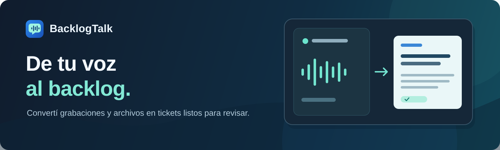
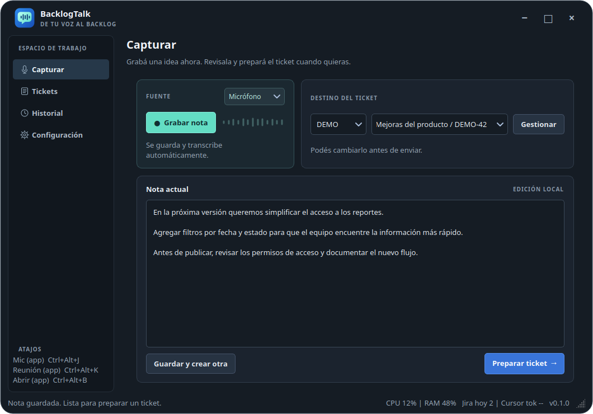

<div align="center">
  
</div>

<h1 align="center">BacklogTalk</h1>

<div align="center">

[](https://github.com/dertin/backlogtalk/actions/workflows/compatibility.yml)
[](LICENSE)
[](docs/guia.md#requisitos)

[](#plataformas)
[](#plataformas)
[](#plataformas)

**De una nota de voz a un ticket listo para revisar.**

BacklogTalk es una aplicación de escritorio de código abierto que convierte grabaciones y notas en borradores de tickets de Jira. Transcribí en tu equipo, prepará el contenido con IA y decidí cuándo enviarlo.

[Empezar](#empezar) | [Cómo funciona](#cómo-funciona) | [Guía completa](docs/guia.md) | [Contribuir](CONTRIBUTING.md)

</div>



## De una conversación a un ticket

Una buena idea no siempre aparece cuando tenés tiempo de escribirla. BacklogTalk te permite capturarla y volver a ella después, con el contexto a mano.

1. **Capturá.** Grabá desde el micrófono, registrá una reunión o importá un archivo de audio o video.
2. **Revisá.** La transcripción se guarda localmente para que puedas corregirla cuando quieras.
3. **Prepará.** Usá Cursor Agent u Ollama para convertir la nota en uno o varios borradores.
4. **Enviá.** Revisá el destino y los campos propuestos; vos confirmás cada creación en Jira.

## Integraciones

| Herramienta | Para qué la usa BacklogTalk |
|---|---|
| **[Jira de Atlassian](https://www.atlassian.com/software/jira)** | Destino de los tickets. Elegís el sitio, el proyecto y, opcionalmente, la épica. |
| **[Teamwork Graph CLI (TWG) de Atlassian](https://developer.atlassian.com/cloud/twg-cli/)** | Consulta tipos y campos de Jira y crea el ticket después de tu confirmación. Requiere autenticación y permisos en tu organización. |
| **[Cursor Agent CLI](https://cursor.com/docs/cli/overview)** | Opción para preparar los borradores y proponer campos con el modelo de Cursor que elijas. |
| **[Ollama](https://ollama.com/)** | Alternativa a Cursor para preparar borradores con un modelo disponible a través de tu servidor Ollama. |
| **[faster-whisper](https://github.com/SYSTRAN/faster-whisper)** | Transcribe audio en tu equipo; descarga el modelo elegido la primera vez que lo usás. |

Cursor y Ollama son alternativas: elegís uno en Configuración. Para publicar en Jira, BacklogTalk invoca TWG directamente después de tu confirmación. Si tenés una idea para sumar otro modelo, agente o plataforma de tickets, [abrí una propuesta o enviá un pull request](#contribuir-y-compartir).

## Cómo funciona

- **Un atajo para capturar:** empezá una nota sin interrumpir lo que estás haciendo. La bandeja muestra cuándo está grabando.
- **Tu historial a mano:** escuchá el audio, editá la transcripción, reintentá una transcripción o borrá lo que ya no necesitás.
- **Instrucciones a tu manera:** definí reglas generales y por proyecto o épica para adaptar el formato y los campos a tu equipo.
- **Revisión antes de publicar:** elegí el proyecto y la épica, comprobá los campos y confirmá el envío mediante TWG. La app conserva la respuesta para consultarla después.
- **Español e inglés:** elegí el idioma y el modelo de transcripción según tus necesidades.

La transcripción se procesa en tu equipo. Si elegís Cursor, el texto necesario para preparar el ticket se envía a Cursor. Si elegís Ollama, la aplicación se comunica con tu servidor local: el procesamiento permanece en el equipo cuando usás un modelo local; un modelo en la nube de Ollama puede enviarle datos al proveedor. [Más sobre privacidad y archivos](docs/guia.md#modelos-instrucciones-y-privacidad).

## Empezar

Necesitás Python 3.12 con pip y PortAudio. Para preparar borradores necesitás [Cursor Agent CLI](https://cursor.com/docs/cli/installation) u [Ollama](https://ollama.com/download); para publicar en Jira, [Teamwork Graph CLI (TWG)](https://developer.atlassian.com/cloud/twg-cli/getting-started/installation/) autenticado y acceso al sitio.

```bash
git clone https://github.com/dertin/backlogtalk.git
cd backlogtalk
```

**Linux y macOS**

```bash
./scripts/install.sh
./scripts/run.sh
```

**Windows / PowerShell**

```powershell
.\scripts\install.ps1
.\scripts\run.ps1
```

En macOS 12/13 con Apple Silicon, PyAV 19.0.2 no ofrece ruedas oficiales para esos sistemas y puede requerir compilación con un FFmpeg compatible. Consultá la [guía de requisitos](docs/guia.md#requisitos).

La primera transcripción descarga el modelo seleccionado. En la aplicación, abrí **Configuración** para elegir el motor y configurar tu sitio y proyecto de Jira. La [guía de instalación y uso](docs/guia.md) incluye dependencias del sistema, permisos, atajos y soluciones por plataforma.

## Plataformas

| Función | Linux | Windows | macOS 12+ |
|---|---|---|---|
| Micrófono e importación de audio o video | Disponible | Implementado | Implementado |
| Grabación de micrófono + salida del equipo | PipeWire y fuente monitor | No disponible | No disponible |
| Atajos globales | Según el escritorio | Requiere configuración del sistema | Requiere configuración del sistema |

La CI ejecuta las pruebas automatizadas en Linux, Windows y macOS. En Windows y macOS todavía falta validar manualmente la interfaz, los dispositivos de audio, los atajos y las integraciones en equipos reales.

## Contribuir y compartir

¿Usás otro modelo, agente o sistema de tickets? Nos encantaría seguir sumando integraciones y funcionalidades junto a la comunidad. Abrí una incidencia para compartir la idea o enviá un pull request: recibimos con gusto contribuciones de código, documentación y pruebas. La [guía de contribución](CONTRIBUTING.md) explica cómo empezar. Para problemas de seguridad, consultá la [política de seguridad](SECURITY.md).

El proyecto se distribuye bajo la [licencia MIT](LICENSE). Compartí el enlace al repositorio con quien pueda encontrarlo útil.
